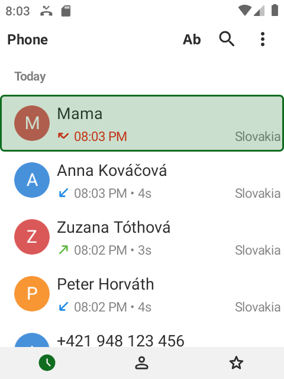
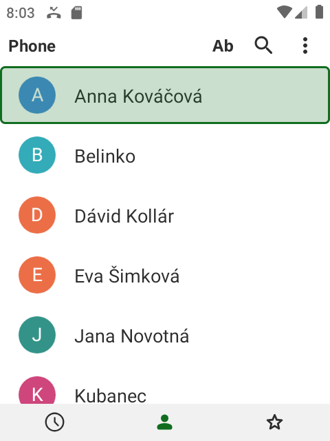
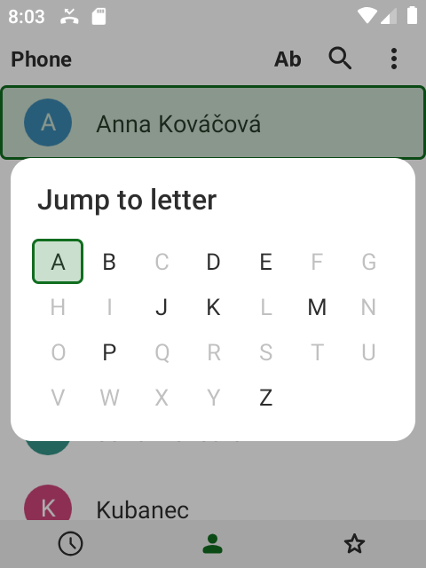
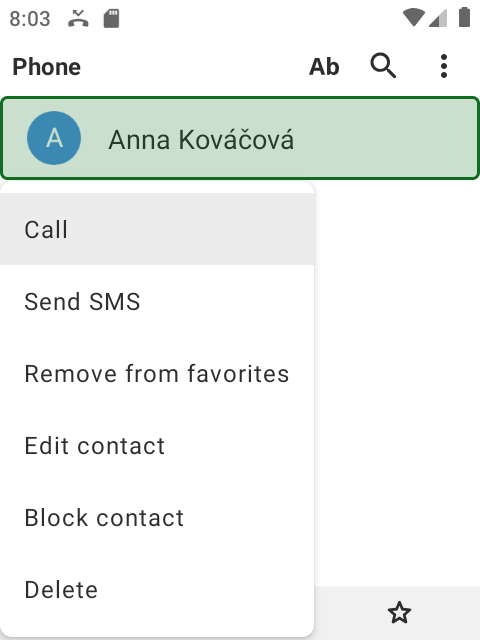
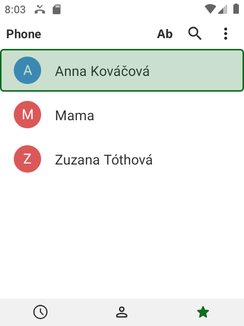
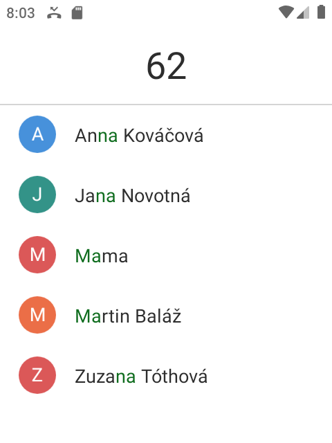
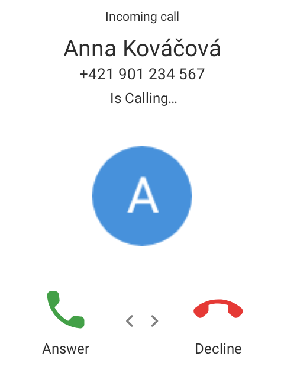
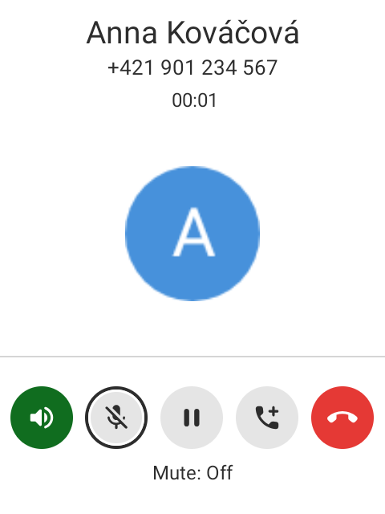
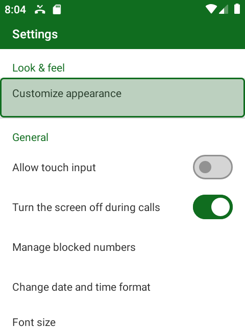
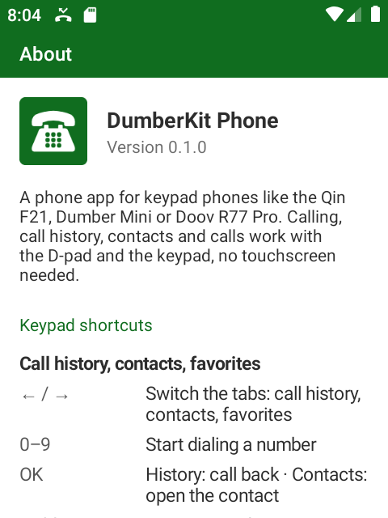

# DumberKit: Phone


[](https://ko-fi.com/lbockaj)

A phone app made for **keypad phones** – the Qin F21, Dumber Mini, Doov R77 Pro and other small Android phones with a
D-pad and a T9 keypad. Dialing, the call history, contacts and the calls themselves work with the keys alone: the
digits start dialing right away, the green key calls, and the call screen is a row of buttons you move through with
← / →. There are no floating buttons, no swiping and no on-screen dialpad, and the layout fits a 480×640 screen.

It's built on [Fossify Phone](https://github.com/FossifyOrg/Phone), and its contact lists look and behave like
[DumberKit: Contacts](https://github.com/lbockaj/DumberKit-Contacts). Touch is switched off inside the app, so
nothing gets pressed by accident in your pocket.

<div align="center">





</div>

## Using it with the keys

### Call history, contacts, favorites

The app opens on the call history with the newest call selected, ready for the green key. The three tabs – **Call
history**, **Contacts** and **Favorites** – are icons at the bottom; **← / →** switch between them and every tab
starts at its first row.

| Key | What it does |
| --- | --- |
| **0–9** | Start dialing a number with that digit |
| **Call** (green key) | Call the selected call or contact (nothing selected: the dialer) |
| **OK** | Call history: call back · Contacts: open the contact in DumberKit Contacts |
| **Hold OK** | Actions: call, send SMS, add to / remove from favorites, edit, block, delete… |
| **#** | Send an SMS to the selected number or contact |
| **\*** or the **Ab** button | Jump to a letter in the contacts (A–Z grid, the keys 2–9 jump like on the keypad) |
| **↑** on the first row | The top bar: jump to letter, search, menu |
| **Menu** | Dialpad, new contact, sort, filter, clear the call history, settings, about |
| **Back** | Jump to the first row; Back again leaves the app |

Search, **Ab** and **\*** always look for contacts. Started from the call history, the history stays on screen while
you type or pick a letter, and the contacts show up once you confirm with **OK**.

### Dialing

The digits type the number into a big field on top, the contacts whose number or name matches it (T9, so 62 finds
*Ma*ma and *Ma*rtin) are listed below. No on-screen dialpad and no keyboard get in the way.

| Key | What it does |
| --- | --- |
| **0–9**, **\***, **#** | Type the number |
| **Call** or **OK** | Call the number (or the selected contact); with nothing typed it puts in the last dialed number |
| **↓ / ↑** | Pick one of the matching contacts |
| **Back** | Delete the last digit; with nothing typed it closes the dialer |
| **Hold Back** | Delete the whole number |
| **Hold 0** | + for international numbers |
| **Hold 2–9** | Speed dial |
| **Menu** | Pick the SIM, add to contacts, send SMS, add a pause or a wait, speed dial numbers |

<div align="center">





</div>

### Incoming call

The caller's photo (or the colored letter from the contact lists) sits in the middle, *Answer* on the left and
*Decline* on the right.

| Key | What it does |
| --- | --- |
| **Call**, **OK** or **←** | Answer |
| **→** | Decline |
| **Back** | First press: silence the ringing · second press: hide the screen, the call keeps ringing silently |

Opening the app while a call rings brings the call screen back. On phones where the red key is the power button,
Android only silences the ringing with it.

### During a call

On many keypad phones the arrows ↑ / ↓ set the volume during a call, so the call screen uses a row of round buttons
instead: **← / →** pick one, **OK** uses it, and its name and state are shown underneath (*Speaker: On*).

| Key | What it does |
| --- | --- |
| **← / →** | Speaker, mute, hold, add call, hang up (swap and merge with two calls) |
| **OK** | Use the selected button |
| **0–9**, **\***, **#** | Send tones, for automated lines |
| **Call** (green key) | Turn the screen off; green or Back turns it on again |
| **End** (red key) | Hang up – with the screen on and Android's *Power button ends call* switched on |

Keypad phones have no proximity sensor, so the screen stays on at your ear. With *Turn the screen off during calls*
the app switches it off 3 seconds after the call connects, and the ear can't touch anything. Android only lets apps
do that as a *device admin*: the app asks for it once, uses it for nothing else, and the switch in the settings
removes it again. Without it the screen only dims after 10 seconds.

### Settings

Every option is a row you can reach with the arrows, the lists open as dialogs with the current choice selected.

- **Allow touch input** – off by default.
- **Turn the screen off during calls** – the device admin described above.
- The usual Fossify options: blocked numbers, date format, font size, name order, number formatting, tabs, grouping
  of subsequent calls, call confirmation, dialpad vibration and sounds (off by default), speed dial, exporting and
  importing the call history.
- **Colors** – *System* (follows Android), light, dark and other themes; the app icon is green by default and any
  other color can be picked.
- **About** – the version and the keys of every screen.

## Install

The app isn't released yet. Build it from source (see below) and install the APK with `adb install`, then start
**Phone** with the green icon and let it become the default phone app when Android asks.

Requires Android 8.0 or newer.

## Build

```bash
./gradlew assembleFossRelease
```

The release build is signed with the key from `keystore.properties` (see `keystore.properties_sample`), the APK ends
up in `app/build/outputs/apk/foss/release/`.

## License

DumberKit: Phone is free software under the [GNU General Public License v3.0](LICENSE).

## Credits

The core of the app is [Fossify Phone](https://github.com/FossifyOrg/Phone) and its
[Commons](https://github.com/FossifyOrg/Commons) library (GPL-3.0) – calling, the call history, blocking, themes and
translations come from there. DumberKit: Phone is a modified version, reworked in 2026 for keypad navigation and
small screens. Thanks to the Fossify team and its translators.
